 

## 🌌 The AI Universe

## ⭐ Flagship Project

> **ClickClass** — a teacher captures a classroom photograph, and the system uses facial recognition to identify students and mark attendance.
> Built with Python, machine learning and computer vision.

### More Projects

<table>
<tr>
<td width="50%" valign="top">

**🏋️ AI Gym Trainer** 
AI-based fitness assistance. 
`AI` · `Computer Vision`

</td>
<td width="50%" valign="top">

**🎨 Neural Style Transfer** 
Deep learning-based artistic image transformation. 
`Deep Learning` · `Python`

</td>
</tr>
<tr>
<td width="50%" valign="top">

**💳 Loan Approval Prediction** 
Machine learning with Logistic Regression. 
`Machine Learning` · `Scikit-learn`

</td>
<td width="50%" valign="top">

**☁️ Cloud Resume Portfolio** 
Cloud and DevOps-oriented portfolio project. 
`Cloud` · `DevOps`

</td>
</tr>
</table>

## 🔬 The AI Research Lab

## 🧰 Technology Universe

<table>
<tr><td width="200"><b>Programming</b></td><td>
</td></tr>
<tr><td><b>AI &amp; Machine Learning</b></td><td>
</td></tr>
<tr><td><b>Generative &amp; Agentic AI</b></td><td>
 LangGraph · LLMs · RAG · Hugging Face · Agentic AI</td></tr>
<tr><td><b>Automation</b></td><td>
n8n · Automation Anywhere · RPA · AI-powered workflows</td></tr>
<tr><td><b>Development &amp; Cloud</b></td><td>
 REST APIs</td></tr>
<tr><td><b>Developer Tools</b></td><td>
</td></tr>
</table>

## 👩‍💻 About Me

I'm a **B.Tech CSE student specializing in AI & Machine Learning** who loves turning ideas into intelligent applications. I experiment with emerging AI technologies, design agentic workflows, and automate real-world processes, always curious about what comes next.

## 🧭 Developer Journey

**Learn** → **Experiment** → **Build** → **Improve** → *repeat*

*Building intelligence. Automating possibilities. Exploring what comes next.*

## 📡 Connect With Me

&nbsp;&nbsp;
&nbsp;&nbsp;

github.com/aibyp · preethyyyyy555@gmail.com

